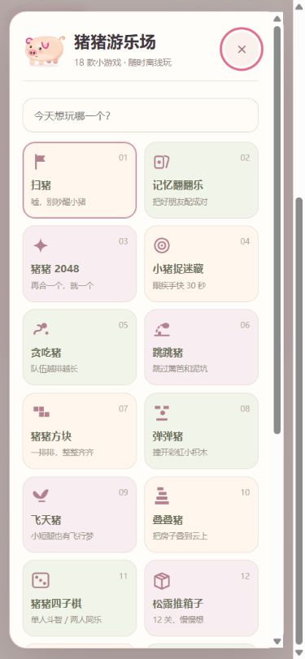

# 猪猪游乐场 🐷

18 款离线小游戏，提供 Windows 便携版、单文件网页和安卓 App 的完整可编辑源码。当前版本 **4.2.0**，项目新增代码与原创美术采用 MIT 许可证；第三方材料保留各自权利。



## 游戏与功能

扫猪、记忆翻翻乐、猪猪 2048、小猪捉迷藏、贪吃猪、跳跳猪、猪猪方块、弹弹猪、飞天猪、叠叠猪、猪猪四子棋、松露推箱子、猪猪点灯、猪猪消消乐、切切猪、猪猪星际守卫、猪猪节奏派对、猪猪轮盘。

- 支持鼠标单击或触屏点按，各款游戏提供操作说明。
- 猪猪轮盘支持三档离线 AI、同屏双人、六种道具和电影感演出。
- 52 套猪猪造型，四段录音与本地合成猪叫，声音工坊可分别调节音量。
- 最高成绩、难度、造型与声音设置保存在本机，无账号、广告或在线后端。
- 安卓版包含触屏大厅、长按标旗、返回键和后台暂停；最低 Android API 26。

本仓库维护 Windows 和安卓两端；通用网页由 Windows 共用的游戏源码生成。

## 源码结构

| 目录 | 用途 |
| --- | --- |
| `desktop/app/` | 游戏规则、界面、SVG 美术、音频和原有许可 |
| `desktop/main.cjs` | Electron 桌面入口与便携存档 |
| `desktop/test*.cjs` | 七组游戏规则、音效和单击操作测试 |
| `desktop/build-single.py` | 生成单文件离线网页 |
| `android/` | Android 原生容器、触屏适配、图标与构建入口 |
| `docs/images/` | 安卓手机尺寸浏览器预览 |

## 生成离线网页

安装 Node.js 和 Python 3 后，在仓库根目录执行：

```sh
python desktop/build-single.py build/猪猪游乐场v4.2.html
```

用现代浏览器打开生成的 HTML。规则、图片与音效全部内嵌，可断网游玩。

## 测试与 Windows 构建

```sh
cd desktop
npm test
npm ci
npm run build:win
```

七组测试只依赖 Node.js，不需要先下载 Electron。Windows 成品输出到 `desktop/dist/`。构建固定使用 Electron 22.3.27、electron-builder 24.13.3 和 32 位便携配置；编译依赖由 `package-lock.json` 锁定。

## 安卓构建

生成触屏网页资产不需要 Android SDK：

```sh
python android/build.py --prepare-only
```

生成 APK 使用 Windows、JDK、官方 Android SDK 构建工具及自己的签名密钥。工具目录布局和参数见 [安卓构建说明](android/README.md)。仓库不包含发行签名密钥或口令。

## 验证范围

4.2 原成稿已完成七组规则与音效测试、Windows 11 启动检查、APK 签名与资源核对，以及手机尺寸下全部 18 款游戏入口检查。本次公开源码另核对网页和安卓资产重建一致性。尚未在真实 Windows 7 或 Android 设备上完成运行验收；预览图来自浏览器。

## 许可证与来源

项目新增代码和原创美术按 [MIT](LICENSE) 开放。既有第三方代码及改编部分保留原版权和 MIT 许可，来源见 [第三方说明](THIRD_PARTY_NOTICES.md) 与 `desktop/app/assets/` 中的许可证。四段录音来自原视频，版权归原权利人，不在项目 MIT 授权范围内；项目的 MIT 许可证不授予这些录音的再利用权。重新分发时应一同保留来源及权利声明。
