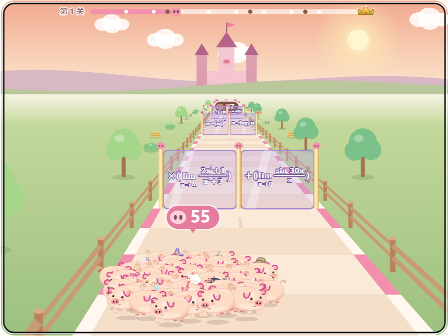

# 猪猪游乐场 🐷

**4.9.2 国际象棋Elo可调：** 共29款离线游戏。国际象棋可拖动滑块或输入1320–3190的目标Elo，默认1500并自动保存。每次落子和提示都先开启Stockfish强度限制，再设置所选等级；思考中调节会取消旧搜索重新计算。[使用与实现说明](docs/4.9.2-chess-elo.md)。

包括六款棋类、Stockfish/皮卡鱼/Rapfi/Egaroucid四套离线引擎，以及其他六款对战人机的增强。安装包通过 [GitHub Releases](https://github.com/tzlh6/piggy-playground/releases) 提供，发布状态以页面为准。Windows最低外壳仍为4.7.1；安卓普通40912、兼容40902、原签名、nativeRevision=5，覆盖安装保留数据，不要先卸载。

本项目自有代码采用MIT，独立棋类引擎保留GPL-3.0，Rapfi网络保留CC0，作者、固定源码地址和完整许可随包提供。四段录音版权归原权利人。个人题库、存档和签名材料不进入公开源码及发行附件。19组回归、桌面和窄屏Elo操作、Chromium 108引擎检查通过；安卓真机和Windows 7实机尚未验收。

十种配色、十种可叠戴的小装饰与 130 个造型 SVG 继续保留，自己的棋子也会跟随当前配色。[装扮玩法](docs/4.8.0-dress-up.md) / [分级目录](docs/4.7.3-study-library.md) / [ZIP 一次导入](docs/4.7.2-android-zip.md) / [输入作答与题库格式](docs/4.7.1-study.md)。安卓真机、Windows 7 实机及真人音效听感尚未验收。


## 4.7.1 新游戏：猪猪爱学习

眼镜猪老师出题，玩家的小猪作答。支持数学、物理、化学、生物、语文、英语，按学科细分题型，可选套卷、难度、题数以及新题优先或错题重练。选择题先选后交卷，多选按原卷给部分分；数学填空有符号键盘和公式预览，英语语法填空输入单词；语文、英语阅读整篇出题、逐小题作答，简答、默写和作文对照答案自评。分值优先读取原卷，难度是按位置和栏目估计的，不是实测数据。

Windows 把自行准备的 `猪猪题库` 文件夹放在 exe 旁边，也可在游戏中导入；安卓通过系统文件选择器导入，离线网页保存在当前浏览器中。公式使用内置 KaTeX 离线显示，题库只在本机读取。4.7.0 没有公开发布，首个公开版本为 4.7.1。[详细玩法与题库格式](docs/4.7.1-study.md)。

## 4.6.1：随机题目与混合运算

出题器先确定答案，再用表达式树随机拆成多步运算，按难度加入乘方、根号、积分、导数、极限等写法；同局和最近 120 个题型尽量避开。四档为加减乘除、平方开方、微积分、混合运算，只有第一档显示蓝 / 红提示。上方大号题卡显示下一排两扇门，过门后揭晓答案和另一扇门的结果。

[出题规则与测试说明](docs/4.6.1-mathgate-questions.md) / [所有运算规则与例题 PDF](https://github.com/tzlh6/piggy-playground/releases/download/v4.6.1/PiggyPlayground-4.6.1-Gate-Rules.pdf)。

## 4.6.0 新游戏：猪猪闯算门



拖动画面、按住左右按钮，或使用 ← / → / A / D 带队选择算式门。门作用于当前猪猪数，结果向下取整并限制为 0–999；野猪一换一，终点每只猪猪扣猪王 1 点血，最后一只打出致命一击也算赢。微积分档过门后揭晓化简结果；每关都有可获胜路线，胜利后进入更难的下一关。[详细玩法、公式与公平性说明](docs/4.6.0-mathgate.md)。

## 4.4.4 新游戏：猪猪跳一跳


按住鼠标、手指、空格或 Enter 蓄力，松开起跳，方向自动朝向下一台。普通落台 +1 分，连续中心 +2、+4、+6、+8、+10；经典挑战与带预估落点的轻松练习分别存档。使用现有 PigArt / PigLook 猪猪造型、表情和音效，没有新增美术素材或模型。参考 MIT 开源 [shenmaxg/web-jump](https://github.com/shenmaxg/web-jump)，已保留完整许可。[详细规则与开发检查](docs/4.5.1-jump.md)。

## 游戏与功能

扫猪、记忆翻翻乐、猪猪 2048、小猪捉迷藏、贪吃猪、跳跳猪、猪猪方块、弹弹猪、飞天猪、叠叠猪、猪猪四子棋、松露推箱子、猪猪点灯、猪猪消消乐、切切猪、猪猪星际守卫、猪猪节奏派对、猪猪轮盘、斗地猪、猪猪跳一跳、黑猪8、猪猪闯算门、猪猪爱学习、猪猪象棋、猪猪国际象棋、猪猪五子棋、猪猪黑白棋、猪猪海战、猪猪围栏。

- 支持鼠标、触屏与键盘；猪猪跳一跳需要按住蓄力再松开。侧栏可按益智 / 敏捷 / 街机 / 对战 / 学习 / 棋类分类筛选，按最近玩过、玩得最多或名称排序；每款游戏都有“游戏说明 / 操作说明”。
- 斗地猪（4.4）：经典斗地主规则（叫 1–3 分，单张到飞机、四带二、炸弹、王炸，炸弹 / 王炸 / 春天 / 反春翻倍）。地主是“邪恶猪猪”，两位农民是“屠夫”；猪猪扑克有猪蹄、猪鼻、松露、卷尾四种花色，J/Q/K 是猪侍卫、猪皇后、猪国王，大王就是邪恶猪猪本猪。人机三档（悠闲 / 聪明 / 恶魔，恶魔会记牌并在残局推演），记牌器、托管、提示、拖动多选；顺子“猪猪小火车”、连对“排排坐”、飞机“飞天猪”、炸弹、王炸“猪王火箭”、报警、春天、捕猪网等动画与音效全部原创。
- 4.4.3：猪猪轮盘新增第 9 件道具「魔术布」，下一颗真屎与假屎互换，不能叠加；双方已有线索同步翻转，公开计数仍按原始装填计算。补给袋为 16 件（泥巴、魔术布各 1 件），三档 AI 都会使用。魔术布有礼帽、红丝绒布、猪仔影子与紫烟的完整演出，盖过的那一颗打出或退出时，小魔术帽飞走。饲料新增放屁、捏鼻与扇手演出，魔法书使用者变身魔法猪。
- 4.4.1：猪猪轮盘全部演出重做（开枪有准星锁定、蓄力、打击停顿与震屏，真屎糊脸、橡皮假屎弹开；八件道具与装填都有新动作；嘚瑟舞改成迪斯科加冕，镜头平滑跟随）；斗地猪一局结束先演结算大戏——屠夫赢了把邪恶猪猪做成烤乳猪吃掉，邪恶猪猪赢了大发神威把屠夫劈成焦炭（`desktop/app/doudizhu-finale.js`）。
- 局域网联机（4.4，Windows 便携版）：同一 Wi-Fi 下一人开猪圈、其他人自动发现并加入（也可手动输入地址），空位补电脑；房主权威、每人只收到自己的手牌；30 秒出牌计时、超时代出、连续超时托管；掉线由电脑代打，同一台电脑重新加入回到原座位。主进程只做发现与转发（`desktop/lan.cjs`），规则与房间逻辑在页面里。
- 猪猪轮盘（4.3）：三阶段积分赛（2 / 4 / 6 血，胜者 +1 / +2 / +3 分，3∶3 加赛），八件道具（新增腐肉、猪蹄），每批弹只公布一次数量，验弹结果只给使用者；同屏双人有回避确认，线索条数按批计、换弹才归零（4.3.1 起，打出验过的那一颗不会让数字变少，查看时显示“已过时”）；发射用的“枪”是一只活的小猪仔，整场胜利跳“猪王嘚瑟舞”。三档离线 AI 只用公开记录和自己的线索。
- Windows 便携版支持联网自动更新：从本仓库 `main` 分支读取 `desktop/update.json`，按其中的提交号只下载游戏内容并逐个校验 SHA-256，重启后生效；新版本启动失败自动退回内置版本。国内网络连不上 GitHub 时改用 jsDelivr 镜像。打开新版本会自动弹出更新说明，跨版本升级时没看过的每一版都完整列出。
- 130 套猪猪造型，十种配色与十种可叠戴的小装饰，四段录音与本地合成猪叫，声音工坊可分别调节音量。
- 最高成绩、难度、造型与声音设置保存在本机，无账号、广告或在线后端。
- 安卓 4.4.3：同步魔术布、饲料屁与魔法猪的共用游戏 4.4.3；保留 4.4.2 对更新功能的修复。4.4.2 修复检查、下载、安装和 GitHub 下载页的按钮调用，增加多个更新地址与 GitHub 官方备用下载入口。沿用 4.4.1 的 19 款游戏与最新版动画，斗地猪提供三档人机对战，手牌与操作按钮放大；触屏大厅支持搜索、分类和排序。新增自动检查、手动下载、进度与校验、系统确认覆盖安装，保留原签名与手机成绩。最低 Android API 26；当前局域网联机仍仅适用于 Windows。

本仓库维护 Windows 和安卓两端；通用网页由 Windows 共用的游戏源码生成。

## 源码结构

| 目录 | 用途 |
| --- | --- |
| `desktop/app/board-ui.js`、`board-session.js`、`board-core.js`、`battleship-core.js` | 六款棋类的界面、动画、规则、电脑与续局 |
| `desktop/app/study-core.js`、`study-math.js`、`study-ui.js` | 猪猪爱学习：题库校验、分科筛选、输入判分与逐题解析 |
| `desktop/app/gate-core.js`、`gate-ui.js` | 猪猪闯算门：随机表达式树、四档难度、单调算式门与猪王结算，题卡与跑道画面 |
| `desktop/app/pool-core.js`、`pool-ui.js` | 黑猪8：固定步长物理、规则 / AI，猪仔球、差异角色与球桌操作 |
| `desktop/app/` | 游戏规则、界面、SVG 美术、音频和原有许可（在线更新只更新这个目录） |
| `desktop/app/version.js` | 版本号与更新说明（打开新版本时弹出） |
| `desktop/main.cjs`、`preload.cjs`、`updater.cjs` | Electron 桌面入口、便携存档与在线更新 |
| `desktop/lan.cjs` | 局域网联机中继：UDP 找房间、TCP 按行转发 JSON（4.4） |
| `desktop/app/doudizhu-*.js` | 斗地猪：规则与 AI（core）、房间与联机（net）、扑克与角色美术（art）、牌桌界面（ui） |
| `desktop/update.json` | 在线更新清单：版本、标签与每个文件的 SHA-256 |
| `desktop/test*.cjs` | 游戏规则、音效、单击操作与斗地猪房间测试（`npm test` 共十六组，含联机中继、跳一跳、黑猪8、闯算门与猪猪爱学习） |
| `desktop/build-single.py` | 生成单文件离线网页 |
| `android/` | Android 原生容器、触屏适配、图标与构建入口 |
| `docs/images/` | 历史界面预览（各图片标注实际版本） |

## 生成离线网页

安装 Node.js 和 Python 3 后，在仓库根目录执行：

```sh
python desktop/build-single.py build/猪猪游乐场v4.7.1.html
```

用现代浏览器打开生成的 HTML。规则、图片与音效全部内嵌，可断网游玩。

## 测试与 Windows 构建

```sh
cd desktop
npm test
npm ci
npm run build:win
```

`npm test` 的十四组测试只依赖 Node.js，不需要先下载 Electron。Windows 成品输出到 `desktop/dist/`。构建固定使用 Electron 22.3.27、electron-builder 24.13.3 和 32 位便携配置；编译依赖由 `package-lock.json` 锁定。

在线更新的端到端测试（本机假服务器 → 下载、校验、重启加载、坏版本回退）：`xvfb-run -a node tools/test-updater.cjs`（Windows 上直接 `node tools/test-updater.cjs`）。斗地猪联机的端到端试玩（同一台电脑开两个 Electron 窗口：开房、发现、加入、整局对打、掉线重连）：`xvfb-run -a node tools/playtest-lan.cjs`。

## 发布一次在线更新

只改了 `desktop/app/` 里的游戏内容时，已经安装满足 `minShell` 的便携版的电脑会自动更新（当前 `minShell` 为 4.7.1，包含题库文件夹接口）：

1. 修改 `desktop/app/version.js`（版本号与更新说明）和 `desktop/package.json` 的 `version`，两者保持一致。
2. `cd desktop && npm test`，然后先把 `desktop/app/` 等改动提交。
3. `npm run manifest` 生成新的 `update.json`（`ref` 取当前提交号，程序按这个不可变的提交号下载文件），再提交 `update.json` 并推送 `main`。

改了 `main.cjs`、`preload.cjs`、`updater.cjs` 或 Electron 版本时，需要重新构建 exe 并在清单里用 `npm run manifest -- --min-shell=<新程序版本>` 提高最低程序版本；旧程序会提示下载新程序，而不是加载不兼容的内容。

## 安卓构建

安卓 App 与共用游戏均为 4.7.3，共 23 款游戏；新增书籍分级目录。普通包 versionCode 为 40713，通过 `android/update-v2.json` 更新；旧更新器兼容包为 40703，通过 `android/update.json` 更新。普通包编号须高于同版兼容包，下一版普通包从 40714 起递增。nativeRevision 为 5，支持 ZIP 一次导入，沿用原签名。可通过「游戏大厅 → 版本与更新」检查、下载并交给系统确认覆盖安装；原 4.2 / 4.4.1 用户先从发行页手动覆盖安装一次。自动检查可关闭，APK 安装前校验 SHA-256、包名、版本和同签名。系统文件选择器、原生联网和覆盖安装流程尚待安卓真机验收。

生成触屏网页资产不需要 Android SDK：

```sh
python android/build.py --prepare-only
```

生成 APK 使用 Windows、JDK、官方 Android SDK 构建工具及自己的签名密钥。工具目录布局和参数见 [安卓构建说明](android/README.md)。仓库不包含发行签名密钥或口令。

## 验证范围

4.7.1（2026-10-21）：公开副本的十四组游戏与联机测试以及版本改号回归通过；猪猪爱学习规则测试 168 项，覆盖分科题型、原卷分值、难度、数学与英语输入判分、阅读题组、自评、筛选及错题本。145 个游戏文件与正式源一致，由公开源生成的 HTML 与发行网页逐字节一致，两个 APK 的内置网页与公开安卓源生成结果一致。既有最终构建验收覆盖 Windows 实际 Chromium 108 程序五轮作答、手机视口单文件网页和安卓内置网页各三轮。安卓真机安装、系统文件选择器、原生联网与运行，以及 Windows 7 实机尚未验证。题库难度为估计；读不懂的数学参考答案改为自评，个人题库本身的问题不等于程序已修正。

4.6.1（2026-10-19，发布核验）：公开副本 13 组游戏与联机测试，加上版本改号回归，共 14 组通过；闯算门含 330372 项检查，覆盖独立数值复算、按显示文字重算、25 种单调 n 门和四档关卡。117 个游戏文件与正式源一致，公开源重生成的 HTML、安卓内置网页与实际附件一致。本版发布前已验收 Windows 实际 Chromium 108 程序，以及手机视口下微积分和混合运算两档的单文件 / 安卓内置网页。安卓真机安装、原生联网更新与运行，以及 Windows 7 实机尚未验证。

4.6.0（2026-10-19，发布核验）：公开副本的十三组游戏与联机测试，加上版本改号回归，共 14 组全部通过；新增闯算门含 98907 项检查。117 个游戏文件已与正式源核对，由公开源重新生成的单文件网页与发行 HTML 逐字节一致，两个 APK 的内置网页与公开安卓源生成结果一致。既有桌面 / 手机宽度浏览器、Windows 实际 Chromium 108 程序、触屏单文件与安卓内置网页试玩记录沿用本版发布前验收；安卓真机安装、原生联网更新与运行，以及 Windows 7 实机尚未验证。

4.4.3（2026-10-13，本机）：十组规则与音效测试、轮盘 5814 项规则检查（含 18 项魔术布专项）、1800 场三档 AI 对局、25/25 单击试玩和 15/15 轮盘生命周期检查通过。魔术布真假对照演出检查、逐帧截图与 Electron 22 打包程序的 19 款入口及新演出检查通过；APK 版本 40403、v2/v3 签名与对齐、沿用原签名以及内置网页和准备源逐字节一致性已核验。尚无真实 Windows 7 运行或安卓手机安装、联网、存档保留实测。历史版本的检查记录保留其实际版本。

安卓 4.4.1（2026-10-12）：APK 构建、原签名一致性与资源核验，32 项更新安全边界检查、360×640 下 19 款入口、390×844 斗地猪点牌与出牌、模拟更新桥接界面检查均通过；尚无安卓原生联网和安装流程实测。

Windows 4.4.1：本版云端已通过十组规则与音效测试、25 项单击试玩、轮盘生命周期 15/15，以及 Electron 22 下 19 款游戏无页面错误检查。下文预览图保留 4.3 / 4.4.0 历史画面，不作为 4.4.1 动画验收证据。本版未新增真实 Windows 7 或多设备局域网运行验收。

4.4：十组规则与音效测试（斗地猪 4.3 万余项规则检查、1090 场三档 AI 完整对局、房主 + 两位客人多局联机与掉线重连、联机中继端到端），25 项只用鼠标 / 触屏的试玩（含斗地猪整局单击与拖动多选），轮盘生命周期 15/15，在线更新端到端，Electron 22 下 19 款入口检查，以及两个 Electron 22 窗口之间的局域网整局对打均已通过。尚未在真实 Windows 7 / 10 / 11 电脑之间实测局域网联机（防火墙提示与路由器隔离只能在真实网络里验证）。

4.3：七组规则与音效测试（轮盘 5788 项规则检查 + 1800 场 AI 完整对局）、23 项只用鼠标 / 触屏的试玩、13 项轮盘生命周期与信息隐藏检查、在线更新端到端测试，以及 Electron 22（Chromium 108，与 Win7 版同内核）下 18 款游戏入口与轮盘演出检查均已通过。尚未在真实 Windows 7 电脑上运行；预览图来自浏览器。安卓 4.2 的验证记录保留原样。

## 许可证与来源

项目新增代码和原创美术按 [MIT](LICENSE) 开放。既有第三方代码及改编部分保留原版权和 MIT 许可，来源见 [第三方说明](THIRD_PARTY_NOTICES.md) 与 `desktop/app/assets/` 中的许可证。四段录音来自原视频，版权归原权利人，不在项目 MIT 授权范围内；项目的 MIT 许可证不授予这些录音的再利用权。重新分发时应一同保留来源及权利声明。
