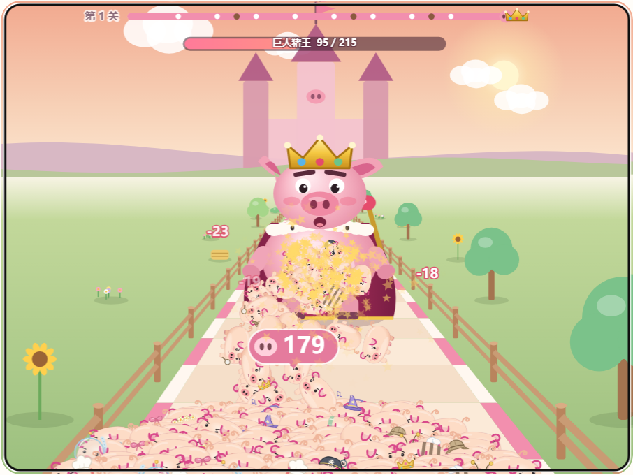

# 4.6.0 · 猪猪闯算门

第 22 款游戏。小猪队沿跑道自动前进，玩家左右带队，从两扇算式门里挑一扇穿过去；途中冲过野猪群，终点用整支猪队打倒巨大猪王。

## 玩法

- **操作**：拖动画面、按住“◀ 左”“右 ▶”，或 ← / → / A / D。领头小猪所在的一侧决定穿过哪扇门；队伍越大越宽，左右可移动范围越窄。
- **门**：式子作用在当前猪猪数 n 上，结果向下取整，范围 0–999。数量变成 0 即结束。
- **野猪群**：一换一，猪猪多于野猪才能冲过去。
- **巨大猪王**：每只扑上去的猪猪扣 1 点血；血量清零即胜（最后一只猪猪打出致命一击也算），剩余猪猪数为成绩。赢了进入下一关，猪王更壮。

## 三档难度

| 难度 | 门 | 颜色提示 |
|---|---|---|
| 加减乘除 | + − × ÷ | 蓝门变多、红门变少（按当前猪猪数计算） |
| 平方开方 | 常数写成 3²、√49、2⁴、2³；另有 n²、√n | 同上 |
| 微积分 | 常数写成十九种写法：∫₀ᵃ 2x dx、∫₀ᵃ 3x² dx、∫₀^π sin x dx、∫₀ᵃ c dx、∫₀² (x+c) dx、(x²)′\|ₓ₌ₐ、(x³)′\|ₓ₌ₐ、(x²+ax)′\|ₓ₌₁、d/dx(ax+b)、lim sin(ax)/x、lim (ax²+1)/(x²+3)、lim (ax+1)/x、lim (x²−a²)/(x−a)、Σ i、log₂ 2ᵃ、m!、e^ln a、A_m²、√(a²)；另有 (n²)′、∫₀ⁿ 2x dx、Σᵢ₌₁ⁿ i、log₂ n、∫₀ⁿ 1 dx 等作用在 n 上的门 | 全部紫色，过门后在上方揭晓化简结果 |

## 公平性

所有门都是单调不减的运算，所以“每扇门都选结果更大的”就是全局最优路线。`makeLevel` 用这条路线计算终点可带的最多猪猪数，猪王血量取其 0.6 / 0.68 / 0.72（每过一关 +0.03，上限 0.94），每一关都有解；输了会显示选对几扇门和本关最多能带几只猪猪。

## 实现

- `app/gate-core.js`：关卡生成、门的运算与公式节点、野猪与猪王结算，不依赖画面与时钟（时间步长输入，不同帧率结果相同）。
- `app/gate-ui.js`：伪 3D 跑道和布景；猪群直接用游乐场的 PigArt 猪猪模型（跟随换装配色，每 5 只一只明星猪猪，表情随过门 / 打架 / 胜负变化），猪猪数增加队伍里就多画一只（最多 160 只）；野猪是同模型的棕色怒眉版；巨大猪王（挥杖、眨眼、受击、倒地、王冠飞出），公式排版（上下标、分数、根号、积分与求和号、lim、竖线取值），粒子与音效。没有新增图片或音频文件。
- `test-gate.cjs`：98907 项检查，逐个公式独立数值复算（定积分用 Simpson、导数用中心差分、极限取近似点），门的单调与取整，最优路线必胜、最差路线必败，帧率无关，野猪一换一和最后一击。
- 参考 [5ubh4d45/CountMasters_Prototype](https://github.com/5ubh4d45/CountMasters_Prototype/tree/da97ed904ee97b186305c51cf32bed94f4828bd8)（MIT）的门加 / 乘结算与按队伍半径收窄左右边界，重新实现为 JavaScript / Canvas；许可见 `desktop/app/assets/licenses/5ubh4d45_CountMasters_Prototype-MIT.txt`。
